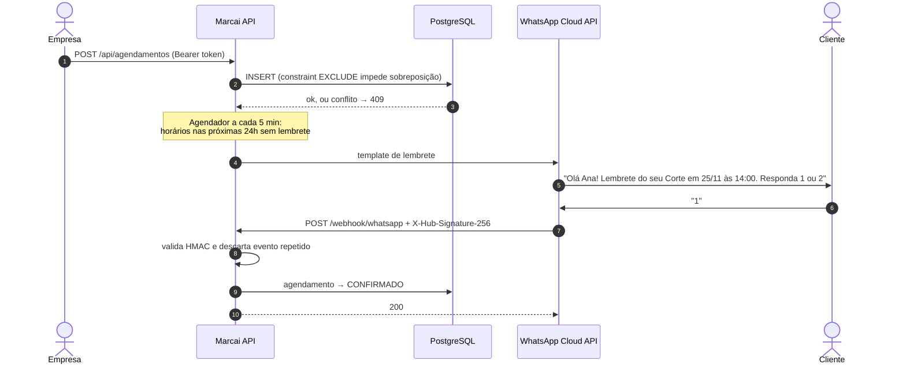

# Marcai

**API de agendamentos que lembra o cliente pelo WhatsApp e registra a confirmação a partir da resposta dele.**

[](https://github.com/lucasdanielalbanocorrea-coder/marcai/actions/workflows/ci.yml)


[](LICENSE)

Faltas sem aviso custam caro para salões, barbearias, clínicas e consultórios. O Marcai envia um lembrete pelo
WhatsApp na véspera do horário. O cliente responde **1** para confirmar ou **2** para cancelar, e a agenda é
atualizada sozinha. Um horário cancelado volta a ficar livre na hora.

<details>
<summary><b>English summary</b></summary>

Marcai is a scheduling REST API (Java 27, Spring Boot 4.2, PostgreSQL) that sends appointment reminders through the
WhatsApp Cloud API and updates the appointment when the customer replies. Highlights: double-booking prevention
enforced by a PostgreSQL exclusion constraint (race-condition safe), HMAC-verified and idempotent Meta webhooks,
OAuth2 client-credentials security, fail-fast secret validation, and integration tests against a real PostgreSQL via
Testcontainers, including an end-to-end reminder flow with a fake Graph API.
</details>

---

## Sumário

- [Funcionalidades](#funcionalidades)
- [Como funciona](#como-funciona)
- [Decisões técnicas](#decisões-técnicas)
- [Stack](#stack)
- [Rodando localmente](#rodando-localmente)
- [Testando sem o WhatsApp real](#testando-sem-o-whatsapp-real)
- [Testes automatizados](#testes-automatizados)
- [API](#api)
- [Estrutura do projeto](#estrutura-do-projeto)
- [Configuração](#configuração)
- [Deploy](#deploy)
- [Roadmap](#roadmap)

## Funcionalidades

- **Agenda sem conflitos:** o banco recusa dois agendamentos no mesmo horário, inclusive com requisições
  simultâneas. O fim de cada horário é calculado pela duração do serviço.
- **Lembrete automático:** um template do WhatsApp é enviado para quem tem horário nas próximas 24h. Se a Meta
  falhar, o envio é repetido na rodada seguinte.
- **Confirmação pela resposta:** "1", "sim" ou "confirmar" confirma; "2", "não" ou "cancelar" cancela. Também
  funciona com os botões de resposta rápida do template.
- **Webhook seguro:** a assinatura HMAC da Meta é conferida em toda mensagem, e cada evento é processado uma única
  vez, mesmo que a Meta o reenvie.
- **API protegida** por OAuth2 e documentada no Swagger.
- **Ambiente de desenvolvimento completo:** Postgres e um WhatsApp falso sobem com um único comando.

## Como funciona



## Decisões técnicas

| Decisão | Por quê |
|---|---|
| **Constraint `EXCLUDE USING gist`** no Postgres para impedir sobreposição | Checar disponibilidade no Java e depois salvar deixa duas requisições simultâneas reservarem o mesmo horário. O banco garante a regra de forma atômica. O intervalo é `[início, fim)`, então horários encostados são permitidos. |
| **Webhook lido como bytes brutos** antes de virar JSON | A assinatura da Meta é calculada sobre os bytes exatos. Reserializar o JSON muda o conteúdo e invalida a verificação. A comparação é em tempo constante (`MessageDigest.isEqual`). |
| **Idempotência com `INSERT … ON CONFLICT DO NOTHING`**, na mesma transação da mudança de status | A Meta entrega "pelo menos uma vez". O insert atômico evita a corrida entre duas entregas iguais. Se algo falhar, o registro do evento também é desfeito e a Meta reenvia, então nada se perde nem é aplicado duas vezes. |
| **Limite de 1 MB no corpo do webhook** | O endpoint é público e o corpo é lido antes de se saber se veio da Meta. Sem limite, qualquer um esgotaria a memória da aplicação. |
| **Lembrete por template**, marcado como enviado só depois do sucesso | Fora da janela de 24h após a última mensagem do cliente, a Meta só aceita templates aprovados. Marcar depois do envio garante nova tentativa quando a API falha. |
| **Segredos validados na inicialização**, sem perfil padrão | O Spring Boot aceita `${VAR}` sem valor e usa o texto literal. Por isso nenhum segredo usa placeholder: eles chegam por variável de ambiente e são validados com `@NotBlank`. Sem eles, a aplicação não sobe. |
| **Testes com Postgres real** (Testcontainers) | `EXCLUDE` e `ON CONFLICT` são recursos do Postgres. Com um banco em memória como o H2, os testes passariam sem testar o que importa. |
| **Pacotes por funcionalidade** (`agendamento/`, `whatsapp/`…) em vez de por camada | O que muda junto fica junto. A integração com a Meta fica isolada em `whatsapp/`. |

## Stack

- **Java 27** e **Spring Boot 4.2** (Web MVC, Data JPA, Validation, Security, OAuth2 Authorization e Resource Server)
- **PostgreSQL 17** com migrações **Flyway**
- **WhatsApp Cloud API** (Meta), chamada pelo `RestClient`
- **springdoc-openapi** (Swagger UI)
- **JUnit 5**, **Mockito**, **Testcontainers**, **WireMock**
- **Docker** (build multi-stage, executado sem root) e **GitHub Actions**

## Rodando localmente

**Pré-requisitos:** JDK 27 e Docker em execução.

```bash
git clone https://github.com/lucasdanielalbanocorrea-coder/marcai.git
cd marcai
./mvnw spring-boot:run
```

O Spring Boot sobe sozinho o PostgreSQL e o WhatsApp falso pelo `docker-compose.yml`, no perfil `dev`.

- **Swagger:** http://localhost:8080/swagger-ui.html (botão *Authorize*: `marcai-dev` / `dev-secret`)
- **Health:** http://localhost:8080/actuator/health

Pela IDE, rode `MarcaiApplication` com o perfil `dev`. Sem perfil, a aplicação exige os segredos de produção e não
sobe, de propósito.

<details>
<summary><b>Exemplo pelo terminal</b></summary>

```bash
TOKEN=$(curl -s -u marcai-dev:dev-secret -d grant_type=client_credentials \
  localhost:8080/oauth2/token | jq -r .access_token)
H=(-H "Authorization: Bearer $TOKEN" -H 'Content-Type: application/json')

curl -s "${H[@]}" -d '{"nome":"Ana","telefone":"5511999998888"}' localhost:8080/api/clientes
curl -s "${H[@]}" -d '{"nome":"Corte","duracaoMinutos":45,"preco":50}' localhost:8080/api/servicos

INICIO=$(date -d '+3 hours' +%Y-%m-%dT%H:00:00%:z)
curl -s "${H[@]}" -d "{\"clienteId\":1,\"servicoId\":1,\"inicio\":\"$INICIO\"}" localhost:8080/api/agendamentos
```
</details>

## Testando sem o WhatsApp real

Em dev, a aplicação fala com um **WhatsApp falso** (WireMock em `localhost:8089`) que imita a Graph API da Meta e
guarda tudo que seria enviado. O agendador roda a cada 30 segundos.

```bash
scripts/mensagens-enviadas.sh                      # o lembrete que "saiu"
scripts/simular-resposta.sh 5511999998888 1        # cliente confirma → CONFIRMADO
scripts/simular-resposta.sh 5511999998888 "não"    # cliente cancela → CANCELADO
scripts/mensagens-enviadas.sh --limpar
```

O `simular-resposta.sh` monta o mesmo JSON que a Meta envia e o **assina com o App Secret**, então passa pela mesma
validação de produção. Com `WHATSAPP_APP_SECRET=errado`, recebe 401.

Para testar com a Meta de verdade sem um número próprio, use o número de teste do painel de desenvolvedor da Meta e
defina `WHATSAPP_API_URL=https://graph.facebook.com/v23.0` no `.env`.

Para apagar os dados de dev: `docker compose --profile dev down -v`.

## Testes automatizados

```bash
./mvnw verify
```

São 20 testes, executados a cada push pelo GitHub Actions:

| Teste | O que garante |
|---|---|
| `AgendamentoServiceTest` | Regras de negócio isoladas (Mockito): cálculo do fim, erros traduzidos corretamente |
| `AgendamentoIntegrationTest` | Conflito de horário recusado pelo banco, cancelamento libera o horário, fluxo HTTP com token real |
| `WebhookControllerTest` | Handshake da Meta, assinatura inválida recusada, corpo gigante recusado, evento repetido aplicado uma vez só |
| `LembreteFluxoCompletoTest` | Jornada completa com Graph API falsa: lembrete → resposta → confirmação, e nova tentativa após falha da Meta |

## API

Todas as rotas `/api/**` exigem `Authorization: Bearer <token>`, obtido em `POST /oauth2/token` (grant
`client_credentials`). Os erros seguem o formato [RFC 9457](https://www.rfc-editor.org/rfc/rfc9457) (*Problem Details*).

| Método | Rota | Descrição |
|---|---|---|
| `POST` | `/api/clientes` | Cadastra cliente. Telefone no formato E.164 sem `+`: `5511999998888` |
| `GET` | `/api/clientes` · `/api/clientes/{id}` | Lista ou busca |
| `POST` | `/api/servicos` | Cadastra serviço; `duracaoMinutos` define o fim do horário |
| `GET` | `/api/servicos` · `/api/servicos/{id}` | Lista ou busca |
| `POST` | `/api/agendamentos` | Agenda. **409** se o horário estiver ocupado |
| `GET` | `/api/agendamentos?de=…&ate=…` | Agendamentos com início em `[de, ate)` |
| `GET` | `/api/agendamentos/{id}` | Busca |
| `POST` | `/api/agendamentos/{id}/cancelamento` | Cancela e libera o horário |
| `GET` `POST` | `/webhook/whatsapp` | Público, usado pela Meta (validado por assinatura) |

## Estrutura do projeto

```
src/main/java/.../marcai/
├── agendamento/        # funcionalidade principal: entidade, regras, API REST
├── cliente/
├── servico/            # tipos de serviço (corte, consulta…) e sua duração
├── lembrete/           # agendador que dispara os lembretes
├── whatsapp/           # integração isolada com a Meta
│   ├── WhatsAppClient  #   envio de mensagens
│   └── webhook/        #   recebimento: assinatura, idempotência, interpretação
└── shared/             # segurança, OpenAPI, HTTP client e tratamento de erros

src/main/resources/db/migration/   # schema versionado (Flyway)
docker/whatsapp-fake/              # stub da Graph API para desenvolvimento
scripts/                           # simular respostas e ver mensagens enviadas
```

## Configuração

Em produção, tudo vem de variáveis de ambiente (modelo em [`.env.example`](.env.example)). Se faltar uma
obrigatória, a aplicação não sobe.

| Variável | Obrigatória | Descrição |
|---|---|---|
| `OAUTH_CLIENT_ID` / `OAUTH_CLIENT_SECRET` | sim | Credenciais para obter token da API |
| `WHATSAPP_TOKEN` | sim | Token de acesso da WhatsApp Cloud API |
| `WHATSAPP_PHONE_NUMBER_ID` | sim | ID do número remetente |
| `WHATSAPP_APP_SECRET` | sim | Segredo do app Meta, usado para validar o webhook |
| `WHATSAPP_VERIFY_TOKEN` | sim | Token que você define para o handshake do webhook |
| `WHATSAPP_TEMPLATE_LEMBRETE` | não | Nome do template de lembrete (padrão `lembrete_agendamento`) |
| `SPRING_DATASOURCE_URL` / `_USERNAME` / `_PASSWORD` | sim | Conexão com o PostgreSQL |

**Configurando a Meta:**
1. Crie e aprove um template em `pt_BR` com 3 variáveis, por exemplo:
   *"Olá {{1}}! Lembrete do seu {{2}} em {{3}}. Responda 1 para confirmar ou 2 para cancelar."*
2. Cadastre o webhook `https://SEU_HOST/webhook/whatsapp` com o seu `WHATSAPP_VERIFY_TOKEN` e assine o campo
   `messages`.

## Deploy

```bash
cp .env.example .env    # preencha os segredos
docker compose --profile app up --build
```

A imagem é multi-stage (JDK para compilar, só a JRE para rodar), executa sem root e já usa o perfil `prod`. O
PostgreSQL só aceita conexões da própria máquina (`127.0.0.1`) e da rede interna do Docker.

## Roadmap

Limitações conhecidas e próximos passos:

- [ ] **Multiempresa (multi-tenant):** `empresa_id` em todas as tabelas, empresa obtida do token e número de
      WhatsApp próprio por empresa (Embedded Signup da Meta).
- [ ] **Várias instâncias:** lock distribuído no agendador (ShedLock) para não duplicar lembretes.
- [ ] **Chave de assinatura persistente** e clientes OAuth no banco, para os tokens sobreviverem a reinícios.
- [ ] **Vários profissionais por empresa**, com agendas paralelas.
- [ ] Resposta automática ao cliente confirmando a ação.

## Licença

Distribuído sob a licença MIT. Veja [`LICENSE`](LICENSE).

## Autor

**Lucas Correa** · [GitHub](https://github.com/lucasdanielalbanocorrea-coder)
